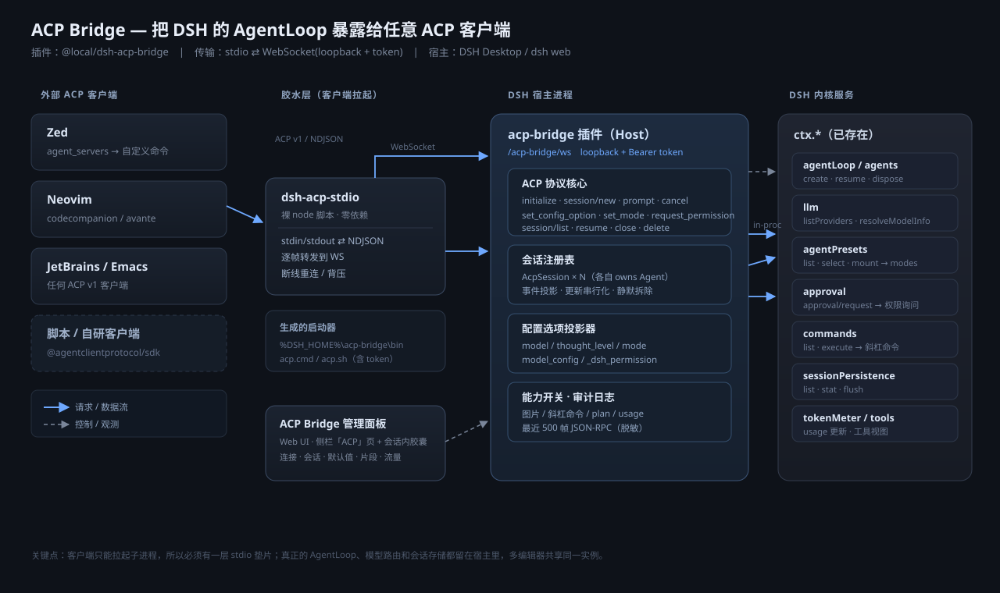
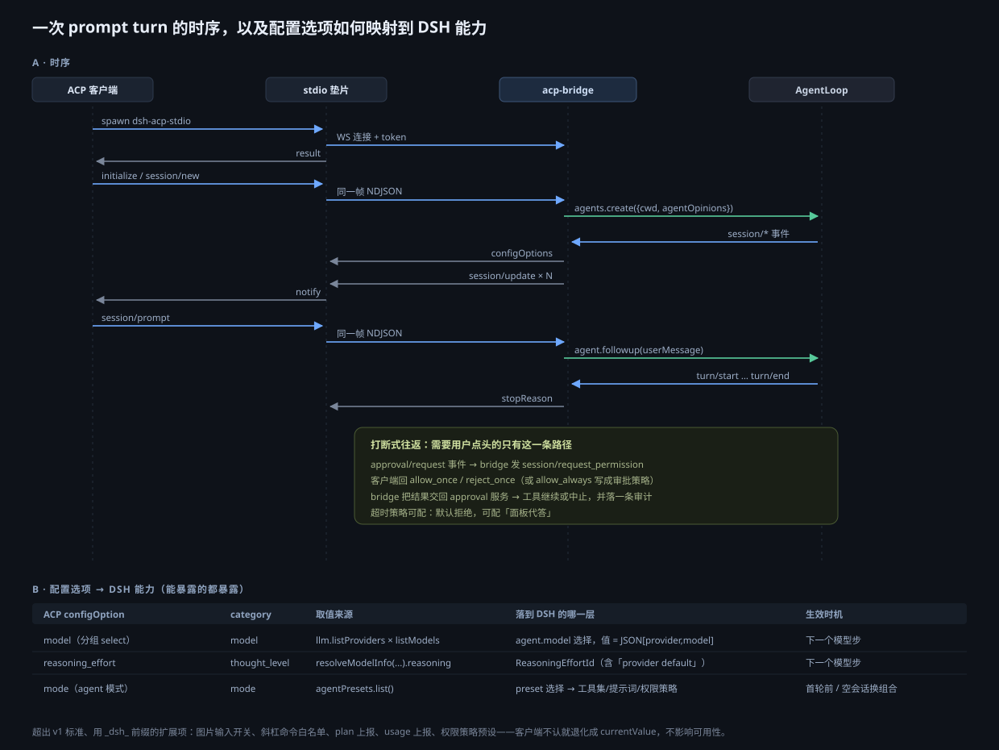
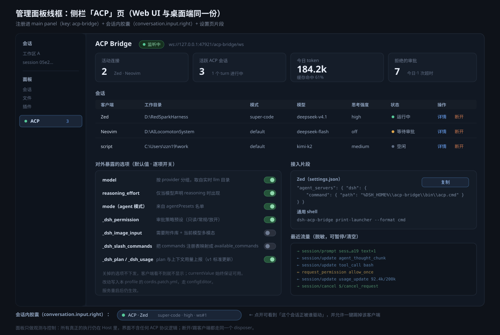

# ACP Bridge — 方案（v0 规划稿）

> 目标：把桌面端 / Web 端跑着的这套 DSH AgentLoop，通过 ACP（Agent Client Protocol）暴露给外部 ACP 客户端（Zed、Neovim、JetBrains、脚本），并配一个管理面板。

---

## 0. 先把已核实的事实摆出来

这几条决定了架构，都是这轮实际查过的，不是推测：

1. **ACP v1 只有 stdio 一种传输**（`/protocol/v1/transports.md`）。客户端负责 spawn 一个子进程，用 NDJSON 走 stdin/stdout。Streamable HTTP / WebSocket 目前还停在 RFD（`rfd/streamable-http-websocket-transport`）。
   → 编辑器不会连我们的端口，它只会拉子进程。**必须有一层 stdio 垫片**。
2. **DSH 已自带 `@deepseek-ai/dsh-acp@0.2.2-rc.1`**（装在 `app.asar/dsh/node_modules`），但它被明确定义为 *automation-only*：只有 `model` + `reasoning_effort` 两个 configOption，`modes` / `commands` / `plans` / `terminals` / `elicitation` / 客户端 fs 全部在 README 的「Known Limitations」里写着"不支持"。
3. 这个包的 `apply` 里写着 `config.stream ?? ndJsonStream(stdout, stdin)`，但 `Config` schema 只声明了 `provider/model/sessionListPageSize` —— **进程外注入 stream 走不通**，只能测试用。也就是说：没法通过配置把它的协议核心接到 WebSocket 上。
4. `@agentclientprotocol/sdk` 在 desktop profile 里是个**空链接**（指向不存在的 `C:\DSH-Home`），所以新插件必须自己声明并安装这个依赖。
5. 宿主侧需要的服务全都在：`agents` / `agentLoop`、`llm`、`agentPresets`、`approval`、`commands`、`sessionPersistence`、`tokenMeter`、`tools`、`mcp-client`、`webServer`（含 `registerUpgrade`）。
6. **agentPresets 只能在首轮之前选**：`select()` 的语义是"会话首轮前"，`recompose()` 要求 blank agent。这条约束会贯穿 ACP 的 `session/set_mode` 实现。

---

## 1. 架构

四层，从外到内：

| 层 | 是什么 | 为什么放这儿 |
|---|---|---|
| **stdio 垫片** `dsh-acp-stdio` | 一个零依赖裸 node 脚本，NDJSON ⇄ WebSocket 逐帧转发 | 客户端只会 spawn 子进程；垫片自己不含任何 agent 逻辑，也不 require 任何 DSH 包，启动 50ms 级 |
| **桥本体** `@local/dsh-acp-bridge`（Host 插件） | ACP 协议核心 + 会话注册表 + 配置投影 + 审计 | 真正的 AgentLoop、模型路由、会话存储都在宿主进程里，多编辑器共享同一实例，会话互相隔离 |
| **核心服务** `ctx.*` | 已有的 Cordis 服务 | 一行不改，桥只做适配 |
| **管理面板**（Client 插件，同一包） | 侧栏「ACP」页 + 会话内胶囊 + 设置片段 | 观测与控制，不含协议逻辑 |

**为什么是 WebSocket 而不是直接给每个客户端一个独立的 agent 进程**：一个垫片进程一个连接，但底下共享同一个 Host。好处是——Zed 里开的会话，在 DSH 面板里能看到、能接管、能踢掉；模型目录和 preset 名单只算一次；token 统计是全局的。

**端口与鉴权**：走 `ctx.webServer.registerUpgrade('/acp-bridge/ws')`，绑定 loopback，`Authorization: Bearer <token>`。token 由插件生成、存进 `ctx.credentials`，写进启动器脚本（不进 `cordis.patch.yml`）。

**启动器**：插件在 `%DSH_HOME%\acp-bridge\bin\` 生成 `acp.cmd` / `acp.sh`，里面把 `node`、垫片路径、WS 地址、token 全内联好。用户在 Zed 里只填这一个路径。面板上有一键复制。

---

## 2. 一次 turn 的时序

要点：

- `session/prompt` 是**一个会话同一时间只能有一个在飞**（与官方 `dsh-acp` 一致），`session/cancel` 或 JSON-RPC 自带取消都收敛到 `agent.cancel()`。
- 助手输出、思考、工具生命周期、上下文用量，全部由**已提交的 session 事件**投影出来 —— 不是直接抓 provider 流。这样断线重连、多客户端观看到的都是同一份真值。
- 每个会话的 update 投递是**串行**的（一个 `outputTail` promise 链），保证客户端收到的顺序和事件序一致。
- 只有 `approval/request` 会打断式往返，走 `session/request_permission`；客户端要是不实现，桥按配置的超时策略兜底。

---

## 3. 能暴露什么（能力矩阵）

### 3.1 标准 configOptions

| ACP option id | category | 取值来源 | 落到 DSH | 生效时机 |
|---|---|---|---|---|
| `model` | `model` | `llm.listProviders()` × `listModels()`，按 provider 分组 | `agent.model` 选择，值是不透明的 `[provider, model]` | 下一个模型步 |
| `reasoning_effort` | `thought_level` | `llm.resolveModelInfo().reasoning`，含「Provider default」 | `ReasoningEffortId` | 下一个模型步 |
| `mode` | `mode` | `agentPresets.list()` | preset 选择（工具集 / 提示词 / 权限策略） | **仅首轮前**，之后拒绝 |

`mode` 同时输出 v1 旧字段 `modes: {currentModeId, availableModes}` —— 规范要求过渡期两者并存且保持同步，老客户端只认 `modes`。

### 3.2 `_dsh_` 前缀的扩展项

规范说 `_` 开头的 category 供自定义使用；客户端不认就忽略、退回 `currentValue`，不影响可用性。

| 扩展项 | 作用 |
|---|---|
| `_dsh_permission` | 审批策略预设（只读 / 常规 / 放开），映射 `approval.setPolicy` |
| `_dsh_image_input` | 图片 prompt 开关（前置条件：附件库存在 + 当前路由声明 image modality） |
| `_dsh_slash_commands` | 把 `commands` 注册表映射成 v1 的 `available_commands` |
| `_dsh_plan` | 把 todo / plan 投影成 v1 的 plan 更新 |
| `_dsh_usage` | 上下文占用与累计花费上报 |
| `_dsh_terminals` | 是否允许客户端调用宿主 terminal（默认关，安全面比较大） |

### 3.3 会话方法

`session/new` · `list` · `resume` · `close` · `delete` · `set_config_option` · `set_mode` · `prompt` · `cancel` · `update` · `request_permission` —— 全部接。

比官方 `dsh-acp` 多出来的是：`set_mode`、`delete`、`available_commands`、plan、usage 上报的完整化、以及 `_meta` 里带客户端身份。

### 3.4 明确不暴露

- DSH 专属 UI 语义：genui 卡片、actionCards、pet、团队任务面板 —— 这些没有 ACP 对应物，硬塞会把协议搞脏。需要时以 `_meta` 附带只读快照。
- `session/load`（完整转录回放）：需要把整段 session 日志重放成 update 流，工作量不小且容易和 resume 语义打架，放 P2 视需求决定。

---

## 4. 管理面板

三个落点，同一个插件包：

| 落点 | Slot | 内容 |
|---|---|---|
| 侧栏「ACP」页 | `main`（key `acp-bridge`） | 连接数 / 活跃会话 / token / 被拒审批 四个指标；会话表（客户端、cwd、模式、模型、思考强度、状态、踢掉）；暴露选项的逐项开关；接入片段一键复制；最近 500 帧脱敏流量 |
| 会话内胶囊 | `conversation.input.right` | 当前会话正被哪个 ACP 客户端驱动，点开可踢 |
| 设置片段 | `plugins.bundle.config` | 端口、token 轮换、超时策略、日志保留 |

**面板的设计原则**：只做观测与控制，界面里不含任何 ACP 协议逻辑。所有真正的执行留在 Host；「断开」「踢客户端」都调同一个 disposer，和客户端自己退出走同一条路径。

选项开关的持久化走 `ctx.configEditor.edit(entry, ...)` 写 profile 的 `cordis.patch.yml` —— 不是自己拼 YAML。

---

## 5. 分期

### P0 — 打通（可验收的最小闭环）

- 插件骨架：bundle manifest、patch、locale（中/英）、icon
- stdio 垫片 + 启动器生成
- WS 升级路由 + token 鉴权
- 协议核心：`initialize` / `session/new` / `prompt` / `cancel` / `close`
- `model` + `reasoning_effort` 两个 configOption
- 消息 / 思考 / 工具 / 用量投影
- **验收**：Zed 里挂上，能对话、能切模型、能看到工具调用

### P1 — 完整暴露 + 面板

- `mode`（agentPresets）+ `modes` 兼容字段
- `session/list` / `resume` / `delete`
- `session/request_permission` + 超时策略
- `available_commands`、plan、usage 上报
- 管理面板三个落点
- 审计日志与流量面板
- **验收**：Neovim 与 Zed 同时连，各自独立会话，面板能看见两个、能踢掉一个

### P2 — 加分项

- Streamable HTTP 直连（给非编辑器客户端，RFC 还在 draft，先只做自家格式）
- `session/load` 转录回放
- terminal / fs 能力透传（需要客户端声明 capability）
- 会话 fork（`session/fork`，ACP 已有 RFD）

---

## 6. 风险与对策

| 风险 | 对策 |
|---|---|
| SDK 依赖在 profile 里缺失 | 插件自己 `dependencies` 声明 `@agentclientprotocol/sdk`，由 `install_bundle` 装 |
| `registerUpgrade` 与现有 WS 路由冲突 | 用 `/_acp/ws` 这类专属前缀，注册失败即报错不静默 |
| 客户端 spawn 时拿不到 `node` | 启动器内联当前进程的可执行路径（`process.execPath`，桌面端即 Electron 二进制 + `ELECTRON_RUN_AS_NODE`） |
| 断线导致会话卡在「等待审批」 | 连接 dispose 时把所有 in-flight 审批按策略结算，并取消该连接持有的会话 |
| preset 在首轮后不可改 | `set_mode` 返回明确的 invalid-params，并在 `mode` 选项上置 `description` 说明 |
| 多个桥实例争同一端口 | 端口冲突时自动 +1 重试并在面板上报实际端口 |

---

## 7. 需要你拍板的几点

1. **传输面**：只做 stdio 垫片（编辑器够用），还是同时做 WS 直连（方便脚本 / 自研客户端）？我倾向两者都做，stdio 为默认。
2. **`mode` 的语义**：直接等同 `agentPresets`（工具集/提示词/权限一起换），还是另建一套更细的「模式」只切权限策略？我倾向直接用 preset，语义单一、不造新概念。
3. **审批默认策略**：无头客户端（脚本）遇到审批时，是自动拒绝、还是挂起到面板代答？我倾向"挂起 + 面板可代答，超时默认拒绝"。
4. **要不要给客户端 terminal / fs 权限**：这是安全面最大的一项，P2 再开，默认关。
5. **包名与发布**：`@local/dsh-acp-bridge` 本地装，还是走 npm 发布？如果只是自用，本地装最省事。
